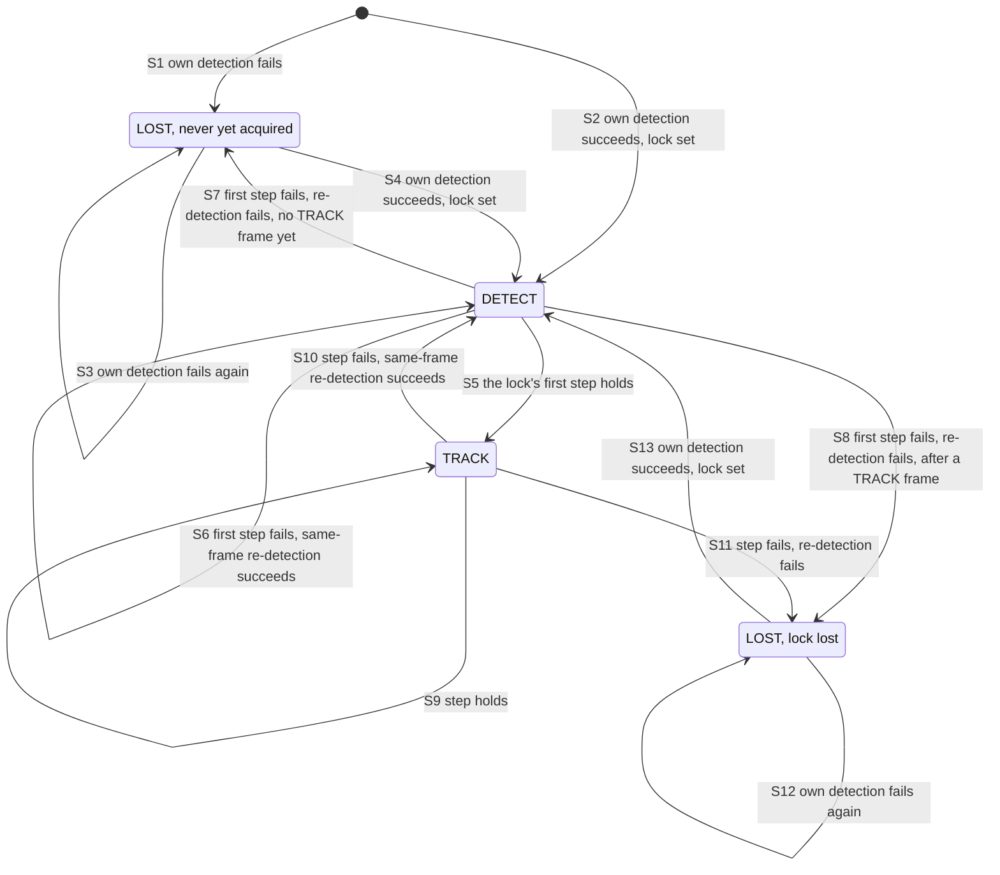
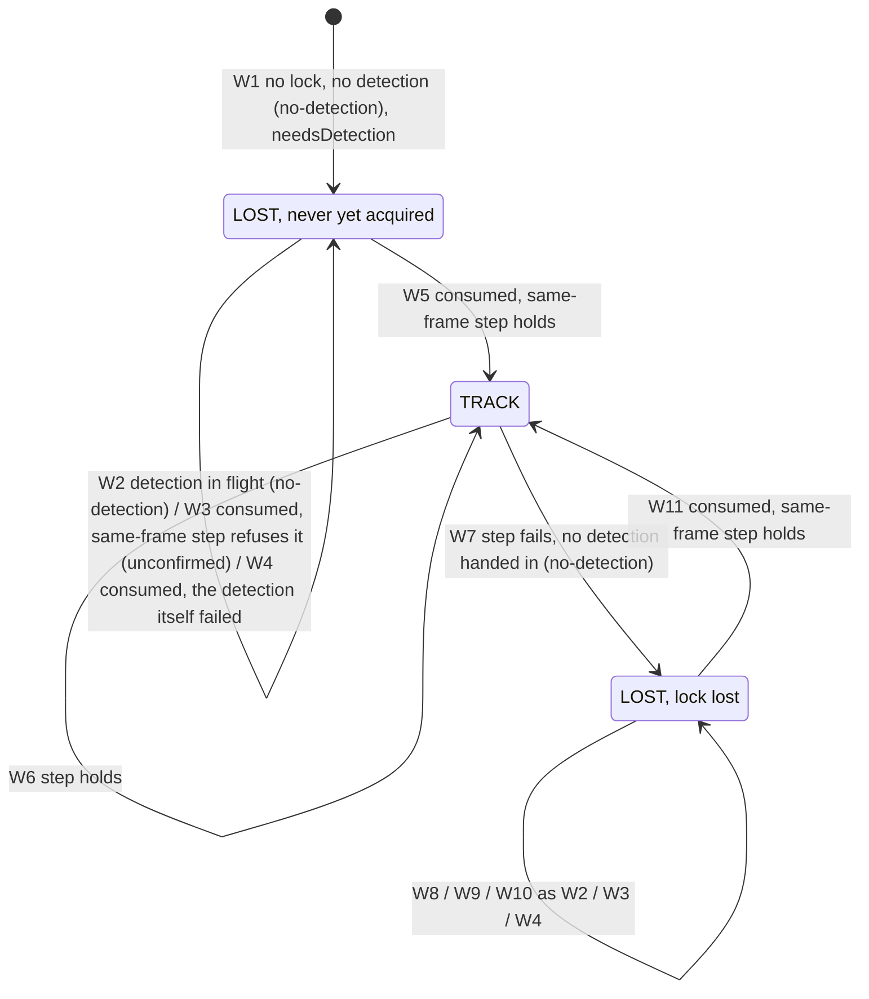

# Benchmark glossary

The words this directory's plans and records use for how a measurement is
made and read, each with the place that defines it. The plans and their
results are in [`README.md`](./README.md), in date order; the records beside
it are named by date.

- **An entry points; it does not define.** A definition copied here would be
  one more place the fact lives, and the first to go stale
  ([#102](https://github.com/webarkit/webarkit/issues/102), Part 4, its
  first rule).
- **Where no single sentence defines a term,** the entry says where its
  parts are. A few entries add a line of orientation: what a term is not,
  or which sense a section uses.
- **Measurement vocabulary only.** How the milestones are named and
  numbered is not here (#102, Part 1).

## M4's campaign

The words M4's campaign minted after #102 was opened on 2026-10-02, with
the older words each is easily taken for.

- **Counted run.** No single sentence defines it. Its parts:
  - the setup it runs under, and the validity rules it passes: M4's plan,
    [its first entries](./README.md#2026-10-13--m4-the-plans-first-entries-the-setup-and-the-pre-flight-run),
    "The setup, the same for every counted run" and "Validity rules";
  - the run-level checks read before the jitter clause:
    [the clause's item 1](./README.md#the-null-controls-jitter-clause-2026-10-14);
  - which exports are evidence: M4's runbook, step 7
    ([2026-10-06](./README.md#2026-10-06--m4-the-sessions-runbook-provenance-steps)).

  Round 0's runs are not counted runs (the jitter clause's item 3), and the
  pre-flight run is not a session run (M4's first entries, "The pre-flight
  run"). Not a *counted loop*: M3's
  [What is measured, and how it is read](./README.md#what-is-measured-and-how-it-is-read),
  and `SESSION_LOOPS` in
  [the metrics module](../../examples/js/bench-metrics.mjs).
- **Session run.** M3's term, older than the counted run. The page decides
  it and records it as `protocol.sessionRun`: `DEFINITIONS.protocol`, and
  `sessionRunGaps`, in the metrics module.
- **Round.** Two senses. M4's: the jitter clause's item 3, its round-0
  bullet, which also says how the other rounds are named. The tuning
  pass's: [The rounds](./README.md#the-rounds).
- **Block, arm, baseline arm.**
  [The null control's jitter clause](./README.md#the-null-controls-jitter-clause-2026-10-14):
  "Why a comparison stays inside one block", and its item 1 for the
  baseline arm. Two older senses: M3's bracketed blocks (below), and the
  detection arms, `sync` and `worker`, which round 0's arm test compares
  (the clause's item 3).
- **Instrument, subject, input, what is outside all three, the role rule,
  and the toolchain.**
  [The instrument, the subject and the inputs](./README.md#the-instrument-the-subject-and-the-inputs-2026-10-14).
  Not the section of M3's plan with a similar name,
  [The instrument](./README.md#the-instrument), whose scope includes the
  worker path M3 measured.
- **Manifest.** `examples/dist/provenance.json`: the opening comment of
  [`scripts/build-provenance.mjs`](../../scripts/build-provenance.mjs),
  which writes it; what Start checks against it, M4's runbook, step 4
  ([2026-10-06](./README.md#2026-10-06--m4-the-sessions-runbook-provenance-steps));
  in an export, `provenance` (`DEFINITIONS.provenance`).
- **Gross-abnormality filter.** The jitter clause's item 1; what it buys,
  the power tables in its item 3.
- **Within-block standard deviation: s₀, s₋b and s_r.** The jitter clause's
  item 3. Round 0's s₀:
  [Round 0's result](./README.md#round-0s-result-2026-10-14).
- **Operational reading, reading of record.** The jitter clause's item 3;
  what each decides, its item 5.
- **The three validity rules.** M4's plan,
  [its first entries](./README.md#2026-10-13--m4-the-plans-first-entries-the-setup-and-the-pre-flight-run),
  "Validity rules, read at analysis time from each committed export"; from
  round 1, rules 2 and 3 as
  [The instrument, the subject and the inputs](./README.md#the-instrument-the-subject-and-the-inputs-2026-10-14)
  changes them. Not the earlier plans' validity checks:
  [the `maxKeypoints` sweep's](./README.md#validity-checks-before-reading-any-timing),
  [M2's](./README.md#validity-checks-before-reading-any-number), and M3's
  runbook, step 7, in [The session's runbook](./README.md#the-sessions-runbook).
- **Pre-flight.** Three things carry the name:
  - M4's pre-flight run, on the tablet: M4's plan,
    [its first entries](./README.md#2026-10-13--m4-the-plans-first-entries-the-setup-and-the-pre-flight-run),
    "The pre-flight run";
  - M3's desktop pre-flight:
    [The desktop pre-flight](./README.md#the-desktop-pre-flight), and its
    record, [`2026-09-30-desktop-m3-preflight.md`](./2026-09-30-desktop-m3-preflight.md);
  - the earlier plans' pre-flight steps:
    [the `maxKeypoints` sweep's](./README.md#pre-flight-where-the-budget-binds-per-clip),
    and [M2's](./README.md#pre-flight-a-desktop-replay), with its record,
    [`2026-09-25-desktop-replay.md`](./2026-09-25-desktop-replay.md).
- **Calibration block.** The jitter clause's item 3, its round-0 bullet;
  the procedure,
  [Round 0, the calibration block: the session's procedure](./README.md#round-0-the-calibration-block-the-sessions-procedure-2026-10-14);
  the result, [Round 0's result](./README.md#round-0s-result-2026-10-14).
- **Session record, audit record.**
  [A correction's account is not part of the record it corrects](./README.md#a-corrections-account-is-not-part-of-the-record-it-corrects-2026-10-14).
  Round 0's pair:
  [the session record](./2026-10-14-tab9-m4-calibration-session.md) and
  [the audit record](./2026-10-14-tab9-m4-calibration-audit.md). M3's
  predate the rule: [its session record](./2026-10-01-m3-device-session.md)
  and [the write-up's audit](./2026-10-01-m3-write-up-audit.md).

- **Pose stage on tracker arms, ambiguous frame, fallback frame.**
  [#105's criteria, and the pose stage on tracker arms from round 1](./README.md#105s-criteria-and-the-pose-stage-on-tracker-arms-from-round-1-2026-10-15),
  and [#132](https://github.com/webarkit/webarkit/issues/132) for the
  finding. The selection rule, its margin and what the two counters count:
  [the acceptance criteria](./2026-10-15-m4-step3-ippe-acceptance.md), §5.
  Not the `pose` stage of the stateless arm, which stays a measurement.

- **Steadiness.** The corners' deviation under `H`, per `DEFINITIONS.jitterPx`
  in [the metrics module](../../examples/js/bench-metrics.mjs): a property of
  the homography, not of the pose. The plan's two defining lines are
  `README.md:4140` and `README.md:4150`, in
  [the null control's jitter clause](./README.md#the-null-controls-jitter-clause-2026-10-14);
  neither is restated here. Why the milestone says "homography steadiness"
  since 2026-10-15:
  [What M4's device half measures](./README.md#what-m4s-device-half-measures-and-which-steps-reach-it-2026-10-15).

## The earlier plans

The words #102 listed on 2026-10-02, from M2's and M3's plans.

- **Registered plan.** The tuning pass's opening paragraph,
  [M3: the tuning pass](./README.md#2026-09-28--m3-the-tuning-pass). What
  binds an M4 session: "What the plan rests on", in M4's
  [first entries](./README.md#2026-10-13--m4-the-plans-first-entries-the-setup-and-the-pre-flight-run).
  How a registered clause was withdrawn and replaced after its result was
  seen: M3's runbook, step 8, in
  [The session's runbook](./README.md#the-sessions-runbook). What a
  registration discloses of the data seen before it: "What was seen before
  it was written", in
  [the jitter clause](./README.md#the-null-controls-jitter-clause-2026-10-14).
- **Tuning pass, and its rounds.**
  [M3: the tuning pass](./README.md#2026-09-28--m3-the-tuning-pass) and
  [The rounds](./README.md#the-rounds); its result,
  [The pass](./README.md#the-pass-2026-09-29-not-tunable-above-the-contract).
- **Desktop baseline.** [The desktop baseline](./README.md#the-desktop-baseline),
  and its record,
  [`2026-09-28-desktop-tuning-baseline.md`](./2026-09-28-desktop-tuning-baseline.md).
- **Guard check, guard diff, guarded paths.** Two things share the word.
  - The independent check of the evidence guards: M3's runbook, step 1, in
    [The session's runbook](./README.md#the-sessions-runbook), and
    [its record](./2026-09-30-m3-guard-check.md); M4's, "The independent
    check of the evidence guards (2026-10-13)", in M4's
    [first entries](./README.md#2026-10-13--m4-the-plans-first-entries-the-setup-and-the-pre-flight-run),
    and [#120](https://github.com/webarkit/webarkit/issues/120).
  - The guard diff, over the guarded paths: M3's runbook, step 1; M4's
    runbook, step 1
    ([2026-10-06](./README.md#2026-10-06--m4-the-sessions-runbook-provenance-steps));
    and from round 1,
    [The instrument, the subject and the inputs](./README.md#the-instrument-the-subject-and-the-inputs-2026-10-14).
- **Device session, runbook, ready check.** The tuning pass's
  [A device session](./README.md#a-device-session); M3's
  [A device session](./README.md#a-device-session-1) and
  [The session's runbook](./README.md#the-sessions-runbook), whose step 3
  is the ready check; M4's runbook,
  [2026-10-06](./README.md#2026-10-06--m4-the-sessions-runbook-provenance-steps),
  and round 0's
  [session procedure](./README.md#round-0-the-calibration-block-the-sessions-procedure-2026-10-14).
- **Bracketed blocks.** The tuning pass's
  [A device session](./README.md#a-device-session), "Interleaved, from
  round 2 on"; M3's [A device session](./README.md#a-device-session-1).
  Reading across brackets: "Pooling across brackets is not a registered
  reading", under
  [M3's predictions](./README.md#predictions-and-what-would-refuse-each).
- **Null control.** M3's: [its A device session](./README.md#a-device-session-1),
  and the jitter clause of its runbook's step 8, in
  [The session's runbook](./README.md#the-sessions-runbook). M4's:
  [The null control's jitter clause](./README.md#the-null-controls-jitter-clause-2026-10-14),
  for [#103](https://github.com/webarkit/webarkit/issues/103).
- **Latency transfer.** `--transfer`, in the comment that opens
  [`scripts/replay-clips.mjs`](../../scripts/replay-clips.mjs); M3's
  runbook, step 12, in
  [The session's runbook](./README.md#the-sessions-runbook); how M3 read
  it: the adoption rule and row seven, under
  [M3's predictions](./README.md#predictions-and-what-would-refuse-each).
- **Predictions table, adoption rule.** M3's
  [Predictions, and what would refuse each](./README.md#predictions-and-what-would-refuse-each),
  with the adoption rule under its table. The tuning pass's
  [What every round is judged on](./README.md#what-every-round-is-judged-on)
  and [What adopting a result means](./README.md#what-adopting-a-result-means).
- **The words a row is read with: *met*, *missed*, *refused*, *not
  refused*, *descriptive*, *inconclusive*.** Where each is fixed or used,
  in M3's [predictions](./README.md#predictions-and-what-would-refuse-each)
  and [results](./README.md#results-2026-10-01):
  - *refused* and *not refused*: the predictions table's last column;
  - *met* and *missed*: said of a row's prediction, its "predicted"
    column. M3's session record reads its rows so, in its table of rows
    ([`2026-10-01-m3-device-session.md`](./2026-10-01-m3-device-session.md)),
    and M3's results use *missed*;
  - *descriptive*: "Row five's refusal requires corroboration", under the
    table;
  - *inconclusive*: the runbook's spread rules and null control, and the
    adoption rule.

  Where a descriptive row and a pooled figure stand: "Row five's refusal
  requires corroboration" and "Pooling across brackets is not a registered
  reading", both under the table. What happened when they were given
  verdict words: [the write-up's audit](./2026-10-01-m3-write-up-audit.md),
  F1 and F2.

## Metric terms

Written against `METRICS_VERSION` 1.

Every metric term is defined by its entry in `DEFINITIONS`, in
[`examples/js/bench-metrics.mjs`](../../examples/js/bench-metrics.mjs).
The page's exports carry the definitions they were measured under, as
`definitions`, beside `metricsVersion` (the module's comments on
`DEFINITIONS` and `METRICS_VERSION`). Not every committed export does: the
exports of 2026-09-19 and 2026-09-24, and the two pyramid probes of
2026-09-26, carry no `definitions`.

### `p50` and `p95`

`percentile` and `stats`, in the same module. Before comparing a
percentile from here with one another tool computed, read `percentile`'s
comment.

### `trackShare` and `trackTimeShare`

`DEFINITIONS.trackShare` and `DEFINITIONS.trackTimeShare`: two measures,
with similar names. Why M3 read its lock verdict on the second: "Per
processed frame, and by video time", in M3's
[What is measured, and how it is read](./README.md#what-is-measured-and-how-it-is-read).

### `LOST`: never acquired, or a lock lost

The `LOST` state, as `states` and `trackLoss` count it, covers two
conditions: a frame on which the tracker has not yet acquired the target,
and a lock lost after it was held. The export separates them with no new
field: a frame is **never yet acquired** if and only if no TRACK frame
precedes it in the run; otherwise it is a loss. `reason` is not relied on
to separate them (#143: unchecked). Every count of either in the record
declares which it counts, by
[the plan's rule of 2026-10-17](./README.md#counts-of-lost-frames-and-of-trackloss-declare-what-they-count-2026-10-17).
The state machine itself is `packages/nft-tracker/src/tracker.ts`;
[the diagram below](#the-state-diagram-sync-arm-and-worker-arm) draws it
from that file and the committed exports, every edge cited to both. The
finding, and why the rename to a distinct ACQUIRING state waits for the
post-campaign window:
[#143](https://github.com/webarkit/webarkit/issues/143).

### The state diagram: sync arm and worker arm

Drawn from two sources only: `packages/nft-tracker/src/tracker.ts`, and the
committed exports in `mode: "tracking"` dated 2026-10-14 or earlier, 45 on
the synchronous path and 12 on the worker path. Every state and every edge
is cited to both, in the table under each diagram; what neither source
shows is not drawn, and is listed as not drawn. The two arms are two
figures, sharing no transition, because their difference is the point: the worker arm has no
`DETECT` state on the frame timeline, and the sync arm, which is handed no
detection, emits neither `no-detection` nor `unconfirmed` in any export.

The code emits one label, `LOST` (`TrackingState`, in
`packages/nft-tracker/src/tracking/types.ts`). Each arm draws it twice,
split by [the entry above](#lost-never-acquired-or-a-lock-lost)'s sequence
rule, read on the run: a frame is **never yet acquired** iff no `TRACK`
frame precedes it, and otherwise it is **a lock lost**. Neither `reason`
nor `trackLoss` makes the split: a `DETECT` frame before any `TRACK` frame
sets a lock, and the next frame can drop it with a `trackLoss` while the
run is still never yet acquired (S7).

**The citations.** Code anchors are the functions of `tracker.ts`; export
counts are transitions between consecutive frames, and every one of them
is held to the exports by
[`2026-10-17-glossary-state-diagram-check.mjs`](./2026-10-17-glossary-state-diagram-check.mjs),
which exits non-zero before printing any figure when a count differs, and
whose `--self-test` shows it failing on three perturbations: a flipped
frame in each arm, and a changed `detectionUse` that moves no count. The
sequence rule is read only on the exports that hold their whole run
(`frames.length` equal to `ticks`): the 13 sync exports of 2026-10-01 and
later, and all 12 worker exports; the 32 older sync exports hold a 300-frame
window that may start after the run acquired, so they enter only the counts
that do not depend on it. On those runs a transition is counted three ways:
**before** the run's first `TRACK` frame, **into** that frame, which is the
run's first acquisition, or **after** it, into a later frame, which for a
transition into `TRACK` is a lock set again once the run had acquired.
Reasons in the tables are `reason` on a `LOST`
frame and `trackLoss` on the frame whose step dropped the lock
(`TrackFailure` in `tracker.ts`; `TrackLoss` in
`src/tracking/track_frame.ts`). Corrected on 2026-10-17 after Qodo's review
of [#146](https://github.com/webarkit/webarkit/pull/146) (its two findings,
on `eb34b45`): the tables had counted the transition into a run's first
`TRACK` frame among those after it, so S5's 192 and W11's 161 merged a run's
first acquisition with a lock set again after it, the distinction `LOST`
conflates, never yet acquired against lock lost, merged in the citation
tables of the entry that introduces it; and W6 stated a `detectionUse` value
the check did not count. Both counts are now split and the value is
counted, each held by the check. The spacing directive on each block is
`flowchart.nodeSpacing` and `flowchart.rankSpacing`: in mermaid 11.4.1 the
`state` config's keys of the same names are not read by the
`stateDiagram-v2` layout, measured on these two blocks.

#### The sync arm: the tracker detects on the frame loop

Sync arm, 45 exports, 20,476 frames; the sequence rule read on 13 whole runs:

| edge | `tracker.ts` | the exports |
|---|---|---|
| states | `TrackingState` has the three members `LOST`, `DETECT`, `TRACK`; `process` with no lock and no handed-in detection, not in `externalDetection`, calls `detect`, and `detected` returns `DETECT` on an ok detection and `LOST` with the detection's `reason` otherwise | the three labels are the only `state` values in the 45 exports: 16,114 + 2,085 + 452 + 457 + 522 + 520 + 279 + 2 transitions, each between two of them |
| S1 | `process`: the first frame has no lock, so it detects; `detected` on `!d.ok` returns `LOST`, `reason` the detection's | frame 0 is `LOST`, `too-few-matches`, `trackLoss` null, in 4 of the 13 whole runs: the wall runs `2026-10-01-tab9-m3-sync-wall-1` to `-4` |
| S2 | `process`: "A detection starts a lock with no velocity: `previous = null`" | frame 0 is `DETECT` in 9 of the 13 whole runs: the six static runs, the two table runs, the pre-flight; then frame 1 is `TRACK` in the six static runs |
| S3 | `process`, as S1, on a frame that still has no lock | `LOST` → `LOST` before the run's first `TRACK` frame: 23 in the 13 whole runs; the never-yet-acquired `LOST` frames carry `too-few-matches` 38 times and `no-consensus` 21 times |
| S4 | `process`, as S2 | `LOST` → `DETECT` before the first `TRACK` frame: 36 in the whole runs |
| S5 | `process`: with a lock, `step` runs; it holds, `tracked` returns `TRACK`, `trackLoss` null | `DETECT` → `TRACK`: 522 over the 45 exports; in the 13 whole runs, 13 into the run's first `TRACK` frame, its first acquisition, and 179 into a later one, a lock set again after it. One edge for both, since `DETECT` is one node: a `DETECT` frame is neither of `LOST`'s two conditions |
| S6 | `process`: `step` fails, "The lock goes, and this same frame gets whatever detection there is below"; `detect` succeeds, the lock is set again, the step's `trackLoss` is carried on the `DETECT` result | `DETECT` → `DETECT`: 2,085 over the 45 exports (114 before the first `TRACK` frame and 746 after, in the whole runs); every frame that follows a `DETECT` or `TRACK` frame and is not `TRACK` carries a `trackLoss`, 0 exceptions |
| S7 | as S6, `detect` fails: `LOST` with the detection's `reason` and the step's `trackLoss` | `DETECT` → `LOST` before the first `TRACK` frame: 32 in the whole runs |
| S8 | as S7 | `DETECT` → `LOST` after the first `TRACK` frame: 165 in the whole runs; 452 over the 45 exports, both phases |
| S9 | `step` holds, `tracked`; `step` advances the lock to `{ previous: lock.current, current: r.H }` | `TRACK` → `TRACK`: 16,114 |
| S10 | as S6, from a held lock; the class comment: "A step that fails drops the lock, says why (`trackLoss`), and the same frame is detected again" | `TRACK` → `DETECT`: 520 over the 45 exports; 186 of the 186 lock deaths in the 13 whole runs. [The item-3 addendum](./2026-10-17-104-stage1-probe-item3.md), section 5, reads the same on its replays, which are not committed exports: "Every lock that dies is followed by a DETECT frame, never a LOST one", on its fate table of one window of the wall clip, where six of seven high-inlier instants start a lock that dies, each read on 31 or 32 replays |
| S11 | as S7, from a held lock; the class comment: "a detection that fails is `"LOST"`" | `TRACK` → `LOST`: 2 over the 45 exports, both `no-consensus` with `trackLoss` `too-few-patches`: `2026-09-26-oppo-a72-ondevice-tracking-wall` frame 228 and `2026-09-29-tab9-tuning-r2-p48-s16-table` frame 32; 0 in the 13 whole runs |
| S12 | as S3 | `LOST` → `LOST` after the first `TRACK` frame: 81 in the whole runs; 279 over the 45 exports, both phases |
| S13 | as S4 | `LOST` → `DETECT` after the first `TRACK` frame: 165 in the whole runs; 457 over the 45 exports, both phases |
| no `trackLoss` without a lock | `trackLoss` is set only by `step`, which runs only with a lock; the `LOST` results of `process` and `detected` set none of their own | frames that follow a `LOST` frame and carry a `trackLoss`: 0 |

#### The worker arm: `externalDetection`, the page's on-demand policy

Worker arm, 12 exports, 11,945 frames, all whole runs; the policy is
[the M3 plan's](./README.md#the-policy): a detection starts only on
`needsDetection`, at most one in flight, a stale result handed in and
never filtered:

| edge | `tracker.ts` | the exports |
|---|---|---|
| states | `process` in `externalDetection` never calls `detect`; `consume` with a trackable target returns `TRACK` (`tracked`) or `LOST` `unconfirmed`, and reaches `detected(d)` only for a failed detection, which is `LOST`. `DETECT` is reachable only with `this.track === null`, a detection-only tracker | `DETECT` frames: 0 of 11,945. `detectionUse` `ignored`: 0. `TRACK` frames with `detectionInFlight`: 0 (`DEFINITIONS.trackFramesWithDetectionInFlight`) |
| W1 | `process`: no lock, no detection, `externalDetection`: `LOST`, `reason: "no-detection"`, `needsDetection: true`, `detectionUse: "none"` | frame 0 in 12 of 12: `LOST`, `no-detection`, `detectionUse` `none`, `detectionInFlight` false, `needsDetection` true, `trackLoss` null |
| W2 | as W1, on every later frame without a detection | `LOST` → `LOST` `no-detection` with `detectionInFlight` true, before the first `TRACK` frame: 260. Round 0's four static runs: `detectionInFlight` reads false then true on frames 0 to 5, 0 to 5, 0 to 6, 0 to 4 (`FTTTTT`, `FTTTTT`, `FTTTTTT`, `FTTTT`) |
| W3 | `consume`: `d.ok`, lock set from `d.H`, `step` on this frame fails: `LOST`, `reason: "unconfirmed"`, the step's `trackLoss`, `detectionUse: "consumed"`, `needsDetection` true | `LOST` → `LOST` `unconfirmed`, `consumed`, with `trackLoss`, before the first `TRACK` frame: 111. `detectionInFlight` is false on every one of the 1,276 consuming frames: the detection was handed in, not in flight; the refusing frame asks again, as the policy's item 2 says |
| W4 | `consume`: `!d.ok`, `detected(d)`: `LOST` with the worker's detection's `reason`, `detectionUse: "consumed"` | `LOST` → `LOST` `too-few-matches` or `no-consensus`, `consumed`, before the first `TRACK` frame: 32 and 17 |
| W5 | `consume`: `d.ok`, lock set, `step` holds, `tracked` with `detectionUse: "consumed"` and `detectionLatencyMs` the frame's timestamp minus the detection's | `LOST` → `TRACK` into the run's first `TRACK` frame: 12, one per run, each `consumed` and following a `LOST` frame. Round 0 (`2026-10-14-tab9-m4-calibration-worker-static-1` to `-4`): frame 6, 6, 7, 5; `detectedAt.framesAgo` 6, 6, 7, 5; `detectionLatencyMs` 316.0, 330.1, 339.6, 280.5. M3's static runs: frame 6 and 5, `framesAgo` 6 and 5, 301.5 and 275.5 ms. M3's hand-held runs: frames 34, 41, 83, 79, 84, 76, `framesAgo` 2 or 3, 134.6 to 167.6 ms |
| W6 | `process`: lock held, `step` holds, `tracked`; `detectionUse` `"ignored"` if one was handed in, else `"none"` | `TRACK` → `TRACK`: 8,833; `detectionUse` on the frame entered, counted: `none` 8,833, no other value (`ignored` 0) |
| W7 | `process`: `step` fails, `trackLoss` set, no detection handed in, `externalDetection`: `LOST`, `reason: "no-detection"`, `needsDetection: true` | `TRACK` → `LOST`: 155, every one `no-detection` with a `trackLoss` (`too-few-patches` 68, `poor-fit` 43, `fit-failed` 39, `too-many-outliers` 5), `detectionUse` `none`, `detectionInFlight` false, `needsDetection` true, 155 of 155 |
| W8, W9, W10 | as W2, W3, W4 | after the first `TRACK` frame: `no-detection` in flight 1,409; `unconfirmed` 744; `too-few-matches` 135 and `no-consensus` 76 |
| W11 | as W5 | `LOST` → `TRACK` into a `TRACK` frame after the run's first: 149, a lock set again once the run had acquired. The 12 transitions into the runs' first `TRACK` frames are W5's, counted apart |
| every consumption | `consume` is reached only once the frame holds no lock, whether it began without one or dropped it in this frame's `step` (the two-step case, not drawn) | 1,276 `consumed` frames, every one preceded by a `LOST` frame; outcomes `TRACK` 161, `unconfirmed` 855, `too-few-matches` 167, `no-consensus` 93; `framesAgo` 1 to 7; `detectionLatencyMs` 65.6 to 339.6 |

**What the diagrams do not label.** No edge is a lock birth. The probe
reads a lock as a run of `TRACK` frames attributed to the `DETECT` frame
before it, and counts as a *lasting* lock one of 50 or more counted frames
([the probe](./2026-10-16-104-stage1-probe.md), item 7, "The detections
that start the locks";
[the item-3 addendum](./2026-10-17-104-stage1-probe-item3.md#24-the-lock-births),
section 2.4). So a lasting lock birth is S5 followed by at least 49 more
frames of S9, and S5 alone is not one: the probe counts one-frame `TRACK`
runs on the table clip, "none lasting".

**Not drawn**, because one source shows it and the other does not, or
neither does:

- A frame that drops its lock and consumes a detection on the same frame,
  two steps (`consume`'s `first*` arguments; the `TrackingFields` comment
  on `trackLoss`). In the exports no `consumed` frame follows a `TRACK`
  frame (0 of 1,276): the policy holds no detection while a lock holds.
- `detectionUse: "ignored"`, a detection handed in while the lock holds
  (`process`'s lock branch): 0 frames.
- The detection-only tracker (`detectionOnly`, or a target with no usable
  patches): `DETECT` on every frame, a consumed detection returned as
  `DETECT`, no lock. No committed tracking export runs it.
- The sync tracker handed a detection (`consume` without
  `externalDetection`): no export.
- The stateless arm. It has no tracker: its `DETECT` and `LOST` labels are
  the page's, per `DEFINITIONS.states`, and its exports' `trackLoss` is
  absent or null on every frame.
- The `ACQUIRING` state #143 defers: not in the code.

### Every key of `DEFINITIONS`

One entry per key. [The staleness check](#the-staleness-check) holds this
list to the module.

- `alignment`
- `alignMs`
- `corners`
- `detectionAccounting`
- `detectionLocks`
- `detectionOutcomes`
- `detectionPath`
- `detectionTime`
- `detectionUse`
- `detectionUseFallbackFrames`
- `endedBy`
- `failure`
- `firstStepLatency`
- `firstSteps`
- `fitMs`
- `fits`
- `frameLevels`
- `frameMs`
- `frames`
- `heldLockSteps`
- `jitterPx`
- `jitterWindows`
- `lockLosses`
- `loopWraps`
- `lostVisibility`
- `lowQualityTrackFrames`
- `posedFrames`
- `protocol`
- `provenance`
- `pyramidMs`
- `quality`
- `reacquisitions`
- `reacquisitionsAtLoopWrap`
- `spreadPx`
- `staleReplies`
- `states`
- `summaryMs`
- `summaryMsFrames`
- `trackedPatches`
- `trackFramesWithDetectionInFlight`
- `trackShare`
- `trackStepMs`
- `trackTimeShare`
- `unlockedResidualMs`

## The staleness check

`examples/test/glossary.test.mjs`, in `npm test`, fails in two cases:
- the `METRICS_VERSION` recorded above is not the module's;
- the keys listed above and the keys of `DEFINITIONS` are not the same set.

It reads the module, and changes nothing in it. Why both conditions, and
what neither can see:
[#102](https://github.com/webarkit/webarkit/issues/102), Part 2.
